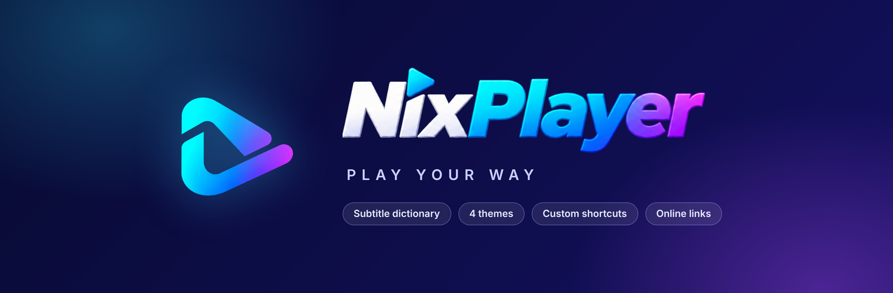
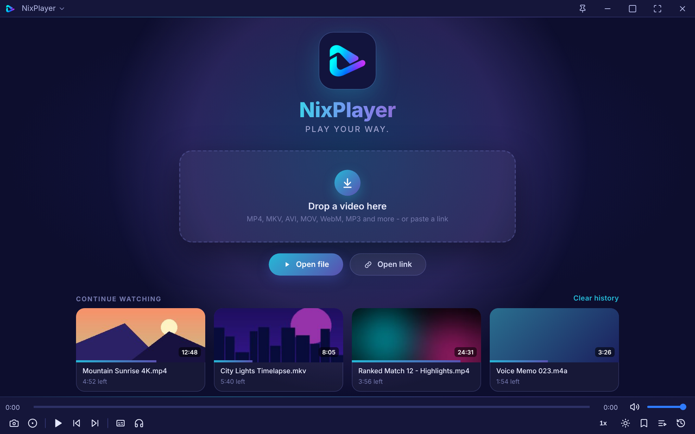
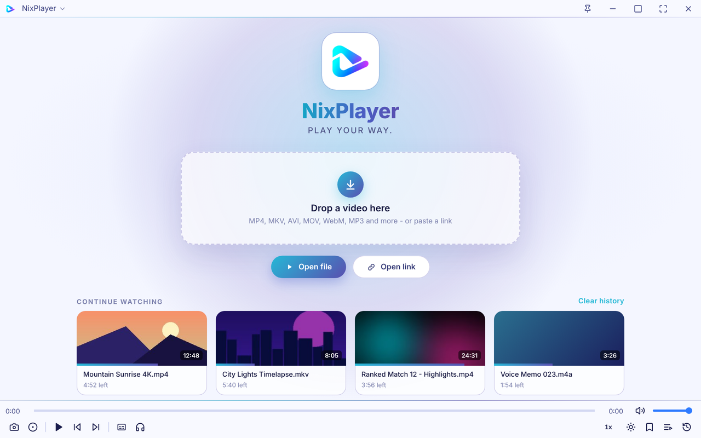
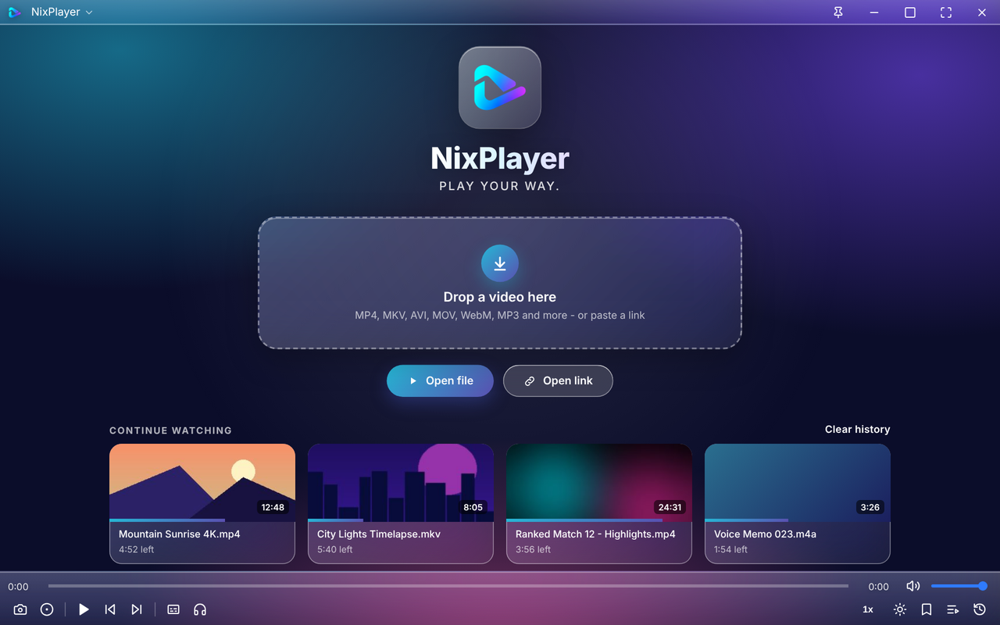

### A clean, minimal Windows video player that you can bend to your own way of watching.

[**⬇ Download for Windows**](../../releases/latest) &nbsp;·&nbsp; [Report a bug or idea](../../issues) &nbsp;·&nbsp; [Changelog](CHANGELOG.md)

---

## Screenshots

| Dark | Light | Glass |
|:---:|:---:|:---:|
|  |  |  |

---

## Why NixPlayer?

| | |
|---|---|
| 📖 **Subtitle dictionary** | Hover a word in the subtitle and see its meaning right away, in 24 languages. |
| 🎨 **Your look** | Dark, Light, Glass or follow Windows, with any accent colour you like. |
| ⌨️ **Everything is yours to change** | Every shortcut can be rebound and every button can be shown or hidden. |
| 🖱️ **Mouse and touch-style gestures** | Hold to speed up, swipe for volume and brightness, choose what a click does. |
| 🌐 **Plays online links** | Paste a video link, or send one from your browser. |
| 🗂️ **Playlist, bookmarks, history** | Resume any video, jump to saved moments, find what you watched. |
| 💡 **Brightness control** | Change picture brightness with a button, a key or a swipe. |
| 🔊 **Louder, clearer sound** | Volume up to 200% plus a loudness boost for quiet movies. |
| 📸 **Screenshot and record** | One key each, saved in the folder you choose. |

---

## Special features

### 📖 Word meaning, dictionary and translator in the subtitles
Learn a language while you watch, without leaving the video.

- **Hover** over any subtitle word to see its meaning in your language (24 languages, Bangla is the default).
- **Click and drag** over several words to get the meaning of the whole phrase.
- **Right-click** a word to open a card that stays on screen, with **definitions, examples, synonyms and antonyms**.
- Choose what a left or right click does: show the card, or search in your browser (Google, Google Translate, Bing, DuckDuckGo, Cambridge Dictionary or your own address).
- Optional: pause the video while a meaning is shown.

### 🎨 Themes and accent colours
- **Dark · Light · Glass · System** (System follows Windows). Glass makes the window see-through, and it is real acrylic on Windows 11. A slider sets how frosted it is.
- Pick an accent colour from the presets or any custom colour. It is used for the progress bar, highlights and switches.
- The layout is the same in every theme, so nothing moves when you switch.

### ⌨️ Every shortcut can be changed
Click a shortcut in **Settings → Shortcuts**, press the new keys, done. Shortcuts are grouped, and one button resets them all. [Default shortcuts](#default-shortcuts) are listed below.

### 🔘 Every button can be turned on or off
Keep the control bar as simple as you want. **Settings → Buttons** lets you show or hide each button, even the volume slider. Open file, Open link, Pop-up play and Window size are hidden by default, so the bar stays minimal.

### 🖱️ Mouse and gestures
- **Hold the left mouse button** to play at 2× (the speed is configurable) and let go to return to normal.
- **Swipe up or down** on the left side for brightness, on the right side for volume (off by default, turn it on in Settings → Controls).
- **Mouse wheel** changes the volume.
- Choose what a **single click** and a **double click** on the video do: nothing, play/pause, fullscreen or mute.
- **Right-click** the video for the NixPlayer menu and Picture settings (brightness, contrast, saturation, flip, aspect ratio).

### 🌐 Online videos and links
- Press **Ctrl+U**, paste a link, or drop a link onto the window.
- Direct video and audio links play at once. YouTube and many other sites work through **yt-dlp**, which NixPlayer downloads and updates by itself.
- HLS streams (`.m3u8`) play too.
- Links keep working after seeking or pausing, because NixPlayer reconnects from the exact position if the server drops the connection.
- **Open from your browser:** NixPlayer registers a `nixplayer://` link. Add this as a bookmarklet and click it on any video page:
  `javascript:location.href='nixplayer://open?url='+encodeURIComponent(location.href)`

### 💡 Brightness control
Adjust the picture brightness without touching your monitor.

- Use the **brightness button** in the control bar, or press `Alt` + `↑` / `↓`.
- Or **swipe up / down on the left side** of the video (turn gestures on in Settings → Controls).
- On-screen feedback shows the new level, and it can be reset any time.
- **Picture settings** (right-click the video, or Settings → Video) also give you contrast, saturation, flip and aspect ratio.

### 🔊 Sound
- **Maximum volume** up to 100 / 125 / 150 / 200%.
- **Loudness boost** (Off, Light, Medium, Strong) lifts quiet speech and keeps loud scenes under control, with a limiter that prevents distortion.
- **Audio track selector.** Movies with AC3, E-AC3 or DTS sound (often silent in other players) are played through the bundled ffmpeg.
- Remembers your volume.

### 🗂️ Playlist, bookmarks and watch history
Pick up exactly where you left off, and find anything again.

- **Playlist (L):** shows a thumbnail and the length of every item. Open several files and they become a playlist. Open one file and the rest of its folder is queued. Repeat one / all and shuffle are built in.
- **Bookmarks (B):** save any moment with a thumbnail preview. Each bookmark also appears as a small marker on the timeline, and one click jumps to it.
- **Watch history (H):** every local and online video with its thumbnail, date and progress. Click one to resume where you stopped. Your most recent videos also appear on the home screen under **Continue watching**.
- You can turn history off or clear it any time in Settings → General.

### 📸 Capture: screenshot and recording
- **Screenshot (S):** saved at the video's real resolution as PNG or JPG.
- **Record (R):** records picture and sound to a `.webm` file.
- Each has its own folder, set in **Settings → Capture**.

---

## Everything else you would expect

- **Subtitles:** `.srt` and `.vtt`, automatic loading of a file with the same name, subtitles inside MKV/MP4, online search, delay (D / F), plus font, size, colours, outline, background and position.
- **Resume** playback where you stopped, and remember each video's subtitle choice.
- **Speed keys** (X / Z / C), frame-by-frame stepping, **timeline preview** on hover.
- **Pop-up play**, real **always on top**, fit window to the video, lock aspect ratio.
- **Fullscreen** where the bars slide away and return at the screen edge.
- **Taskbar buttons:** Previous, Play/Pause and Next on the taskbar thumbnail.
- **Settings search (Ctrl+,):** one box that searches every tab.
- **Automatic updates:** asks "Update now / Later" when a new version is out.

---

## Default shortcuts

| Key | Action | Key | Action |
|---|---|---|---|
| `Space` | Play / pause | `M` | Mute |
| `←` `→` | Skip 5 s | `Shift` + `←` `→` | Skip 10 s |
| `↑` `↓` | Volume | `Alt` + `↑` `↓` | Brightness |
| `Enter` / `F11` | Fullscreen | `T` | Always on top |
| `P` | Pop-up play | `Y` | Subtitles on / off |
| `D` / `F` | Subtitle delay − / + | `X` `Z` `C` | Slower / 1.0× / faster |
| `,` `.` | Previous / next frame | `PageUp` `PageDown` | Previous / next file |
| `S` | Screenshot | `R` | Record |
| `B` | Bookmark | `L` | Playlist |
| `H` | Watch history | `Ctrl` + `O` | Open file |
| `Ctrl` + `U` | Open link | `Ctrl` + `,` | Settings |

All of these can be changed in **Settings → Shortcuts**.

---

## Install

1. Download `NixPlayer-Setup-x.y.z.exe` from the [**Releases**](../../releases/latest) page.
2. Run it. No administrator rights are needed.
3. Double-click any video, or right-click → **Open with → NixPlayer**.

> Windows may show "Windows protected your PC" because the app is new and not code-signed yet. Click **More info → Run anyway**.

NixPlayer opens **MP4, MKV, WebM, MOV, AVI, MP3, FLAC** and more.

### Good to know
NixPlayer is built on Chromium, so it plays H.264, VP9 and AV1 video with AAC, MP3, Opus and FLAC audio. HEVC/H.265 video, some older AVI/WMV codecs, picture subtitles (PGS / VobSub) and DASH-only streams are not supported yet.

---

## License and credits

Free software, © Nasimul Islam Nasim. See [LICENSE](LICENSE). Third-party software (Electron, ffmpeg, hls.js, Lucide icons and others) is listed in [THIRD-PARTY-NOTICES.md](THIRD-PARTY-NOTICES.md).

**NixPlayer, play your way.**

